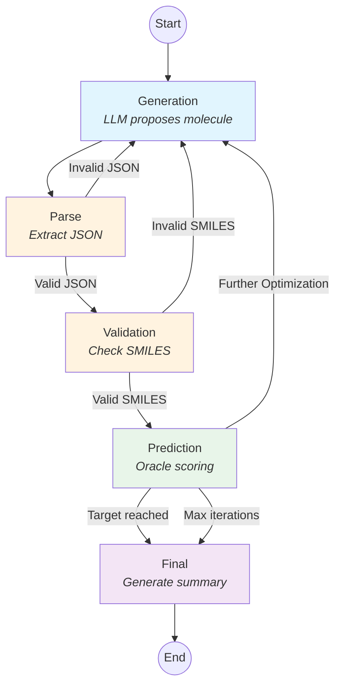

# SEISMO: Molecule Optimization Agent

**S**ample-**E**fficient **I**nference-**S**tage **MO**lecular-Optimization agent

LLM-driven molecular optimization using LangGraph. The agent iteratively proposes molecules, evaluates them with oracles, and optimizes toward a specified objective.

## Workflow



## Installation

This project uses [Pixi](https://pixi.prefix.dev/latest/installation/) for dependency management.

```bash
# Clone and install with pixi
cd molecule-optimization-agent
pixi install
```
## Environment Variables

Set your API key before running:
```bash
export OPENAI_API_KEY=sk-...
```

For custom API endpoints (e.g., corporate proxies), optionally set:
```bash
export OPENAI_BASE_URL=https://custom-endpoint.example.com/v1
```

Or use a `.env` file in the project root (loaded automatically):
```
OPENAI_API_KEY=sk-...
OPENAI_BASE_URL=https://custom-endpoint.example.com/v1  # Optional
```

## Usage

### Command Line

```bash
pixi run seismo --config config/experiments/<your_experiment>.yaml  
# e.g.: pixi run seismo --config config/experiments/similarity.yaml
```

`molopt` still runs the same command and prints a deprecation notice.

### Interactive UI

Launch the Gradio web interface for interactive molecule optimization:

```bash
pixi run seismo-ui
```

`molopt-ui` still launches the UI and prints a deprecation notice. Importing `molopt_agent` still works and emits a `FutureWarning`; use `seismo` instead.

The UI runs at `http://127.0.0.1:7860` and supports:
- **Similarity + QED**: Optimize for structural similarity to a target molecule while maintaining drug-likeness
- **IC50 MPro + QED + Novelty**: Optimize for SARS-CoV-2 MPro inhibition with drug-likeness and novelty constraints

You can provide feedback after each optimization round to guide the agent toward desired molecular properties.

### FastAPI (web PoC)

Start the FastAPI process that serves the health check, preset catalog, job API, and, when present, the built React app from `frontend/dist`:

```bash
pixi run seismo-api
```

For local UI development, run the Vite app in a second terminal (Node/npm come from the `frontend` pixi environment; the task `cd`s into `frontend/` and installs npm deps as needed). It proxies `/api` to `http://127.0.0.1:8000`:

```bash
pixi run frontend
```

Build the production bundle (served by `seismo-api` at `/`):

```bash
pixi run frontend-build
pixi run seismo-api
```

The API listens on `http://127.0.0.1:8000` by default (loopback only). Pass `--port` (or `-p`) to use another port. For container/ALB deploys, bind all interfaces with `--host 0.0.0.0` (or `-H`) or `SEISMO_HOST=0.0.0.0`; the CLI flag wins over the env var. Requires `OPENAI_API_KEY` (and honors `OPENAI_BASE_URL` / `SEISMO_MODEL`) to start jobs. Job records live under `data/web_jobs/`; the CLI (`pixi run seismo --config ...`) still writes under `data/runs`.

To stop stray local API/Vite processes (matched by process name, not by port, so a vLLM serve on 8000 is left alone):

```bash
pixi run kill-web
```

Useful endpoints:

- `GET /api/health` — `status` plus deploy identity (`build_time`, `app_sha`, `deploy_sha`; see below)
- `GET /api/presets`
- `POST /api/jobs` with `{ "preset_id", "params" }` (queues when a job is already running; max 5 waiting)
- `GET /api/jobs` and `GET /api/jobs/{id}` (includes `queue_position` for queued jobs)
- `POST /api/jobs/{id}/cancel` (running or queued jobs)

The Gradio UI (`pixi run seismo-ui`) is unchanged and still available on port 7860.

#### Deploy identity (build metadata)

The Launch and Job pages show a footer with bake-time deploy identity. Values come from environment variables set when the Docker image is built (not from `git` inside the running container). Unset or blank values are reported as `unknown`.

| Env | Role | Health field |
|---|---|---|
| `SEISMO_BUILD_TIME` | ISO-8601 UTC bake time | `build_time` |
| `SEISMO_BUILD_SHA` | SHA of this app (submodule / this repo) | `app_sha` |
| `SEISMO_DEPLOY_SHA` | SHA of the parent deploy repo / image recipe | `deploy_sha` |

Parent CI example (Dockerfile lives in the parent deploy repo; this repo owns the runtime contract):

```bash
SEISMO_BUILD_SHA=$(git -C path/to/molecule-optimization-agent rev-parse --short HEAD)
SEISMO_DEPLOY_SHA=$(git rev-parse --short HEAD)
SEISMO_BUILD_TIME=$(date -u +%Y-%m-%dT%H:%M:%SZ)

docker build \
  --build-arg SEISMO_BUILD_SHA="$SEISMO_BUILD_SHA" \
  --build-arg SEISMO_DEPLOY_SHA="$SEISMO_DEPLOY_SHA" \
  --build-arg SEISMO_BUILD_TIME="$SEISMO_BUILD_TIME" \
  ...
```

In the Dockerfile, pass each build-arg into the image environment:

```dockerfile
ARG SEISMO_BUILD_TIME=unknown
ARG SEISMO_BUILD_SHA=unknown
ARG SEISMO_DEPLOY_SHA=unknown
ENV SEISMO_BUILD_TIME=$SEISMO_BUILD_TIME \
    SEISMO_BUILD_SHA=$SEISMO_BUILD_SHA \
    SEISMO_DEPLOY_SHA=$SEISMO_DEPLOY_SHA
```

## Reproducing Paper Results

All experiments from the paper can be reproduced using the shell scripts in the `scripts/` folder. Each script contains configurable hyperparameters at the top of the file.

### Experiment Scripts

| Script | Description |
|--------|-------------|
| `run_quercetin.sh` | XAI ablation experiments optimizing for Quercetin similarity + QED |
| `run_similarity_qed_pubchem_experiments.sh` | Similarity + QED optimization for 20 random PubChem molecules |
| `run_tdc_tasks_experiments.sh` | PMO benchmark tasks (rediscovery, similarity, isomers, MPO, etc.) |
| `run_ic50_mpro.sh` | IC50 MPro inhibition experiments with QED and novelty constraints |

### Running Experiments

```bash
# Make scripts executable
chmod +x scripts/*.sh

# Run an experiment (e.g., Quercetin XAI ablation)
./scripts/run_quercetin.sh
```

### Baseline Comparisons

Scripts for downloading and running baseline comparisons are in `scripts/baselines/`:

| Script | Description |
|--------|-------------|
| `download_pmo_results.py` | Download PMO benchmark baseline results |
| `tdc_top_50_molecules.py` | TDC top-50 molecules baseline |

### Analysis Notebooks

Jupyter notebooks for analyzing results and generating paper figures are in `analysis/paper/`.

## Configuration

Experiments are defined in YAML config files. Example (`config/experiments/similarity_qed.yaml`):

```yaml
experiment_name: similarity_qed_optimization

log_dir: data/runs
recursion_limit: 150

llm:
  model: claude-sonnet-4-20250514
  temperature: 0.3

oracle:
  name: composite
  params:
    oracles:
      - name: similarity
        params:
          target_smiles: O=C1c3c(O/C(=C1/O)c2ccc(O)c(O)c2)cc(O)cc3O  # Quercetin
      - name: qed
        params: {}
    weights: [0.5, 0.5]
    names: ["Similarity", "QED"]

objective:
  name: similarity_qed
  params:
    target_score: 0.75
    min_similarity: 0.7
    min_qed: 0.7
    max_iterations: 30
```

This example optimizes for molecules similar to Quercetin while maintaining drug-likeness (QED).

## Output

Results are saved to `log_dir` as JSON files containing:

| Key | Description |
|-----|-------------|
| `timestamp` | Run timestamp (YYYYMMDD_HHMMSS) |
| `experiment` | Experiment name from config |
| `conversation` | Full message history (role + content) |
| `trace` | List of iterations with SMILES, scores, and reasoning |
| `iterations` | Total iteration count |
| `summary` | LLM-generated summary of the optimization |

## Project Structure

```
molecule-optimization-agent/
├── src/seismo/             # Main package
│   ├── main.py             # CLI entry point
│   ├── config.py           # YAML config loading
│   ├── state.py            # LangGraph state definition
│   ├── graph/              # LangGraph workflow (nodes, routing, builder)
│   ├── oracles/            # Scoring functions (QED, similarity, IC50, etc.)
│   ├── objectives/         # Optimization objectives and feedback logic
│   ├── ui/                 # Gradio web interface
│   └── api/                # FastAPI app + job API (seismo-api)
├── config/experiments/     # Experiment YAML configs
├── scripts/                # Helper scripts for running experiments
├── analysis/               # Jupyter notebooks for result analysis
└── data/                   # Results and datasets
```

## Extending the Agent

### Adding a Custom Oracle

1. Create `oracles/my_oracle.py`:

```python
from .base import OracleResult

class MyOracle:
    def __init__(self, param1: str):
        self.param1 = param1

    def __call__(self, smiles: str) -> OracleResult:
        score = ...  # Your scoring logic
        return {"score": score, "explanation": ""}
```

2. Register in `oracles/__init__.py`:

```python
ORACLE_REGISTRY["my_oracle"] = MyOracle
```

### Adding a Custom Objective

1. Create `objectives/my_objective.py`:

```python
from ..state import WorkflowState
from ..oracles.base import Oracle, OracleResult

class MyObjective:
    name = "my_objective"

    def __init__(self, oracle: Oracle, target: float, max_iterations: int):
        self.oracle = oracle
        self.target = target
        self._max_iterations = max_iterations

    def first_message(self) -> str:
        return f"Optimize to target {self.target}. Respond with JSON: {{\"reason\": ..., \"smiles\": ...}}"

    def evaluate(self, state: WorkflowState) -> OracleResult:
        return self.oracle(state["current_smiles"])

    def build_feedback(self, state: WorkflowState, result: OracleResult) -> str:
        return f"Score: {result['score']:.2f}. Propose next molecule as JSON."

    def is_done(self, state: WorkflowState, result: OracleResult) -> bool:
        return result["score"] >= self.target or state["iteration_count"] >= self._max_iterations

    def max_iterations(self) -> int:
        return self._max_iterations
```

2. Register in `objectives/__init__.py`:

```python
OBJECTIVE_REGISTRY["my_objective"] = MyObjective
```

